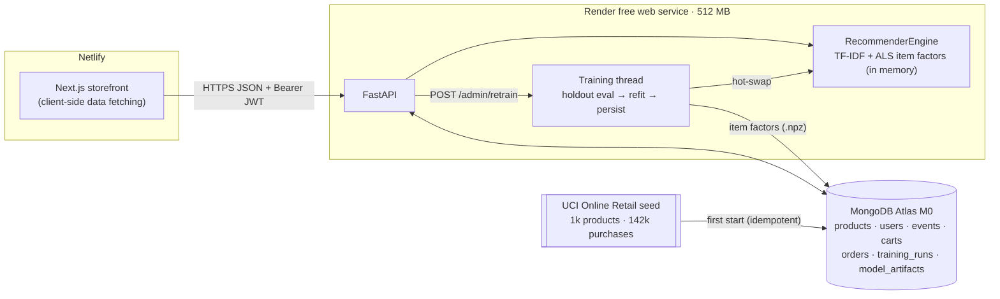

# MarketMind

[](https://github.com/Isaacpyo/MarketMind/actions/workflows/ci.yml)

**Live demo: https://marketmind.temitopeagbola.com** (click **Try the demo**. The API runs on a free
tier that sleeps, so the first request can take 30–60 seconds, and the page tells you when that's
happening.)

MarketMind is a working e-commerce storefront built around a recommendation engine you can inspect.
It serves 1,000 real products and 142k real purchases from a UK gift retailer (the UCI Online Retail
dataset). Every shopper action is recorded as implicit feedback: views, recommendation clicks, cart
adds and purchases. The personalised **For you** feed is a hybrid of **implicit ALS** collaborative
filtering and **TF-IDF content similarity**. It handles brand-new shoppers with popularity and
content-based cold start, and it recomputes your user vector on every request, so it changes as you
browse. Every card explains why it was picked. An admin dashboard shows the model's offline metrics on
a temporal holdout, compared against baselines, and lets you retrain with different hyperparameters.

| For you feed | Model admin |
|---|---|
|  |  |

## Features

- **Storefront**: search, category filters, sorting, pagination, product pages, cart, checkout (an
  order is recorded and no payment is taken), order history, and sign-up/sign-in.
- **One-click demo**: **Try the demo** creates an *isolated* shopper whose history is cloned from a
  real 2011 customer. Visitors never share a cart, and demo data expires through a MongoDB TTL index.
- **Implicit-feedback tracking**: the client can send `view` and `rec_click` events (views are
  de-duplicated). `add_to_cart` and `purchase` events are only written by the server, so they can't be
  forged.
- **For you feed** has three strategies, chosen by how much we know about the shopper:
  1. **Popularity** for brand-new shoppers.
  2. **Cold start** after 1–2 items: TF-IDF similarity to what you touched, blended with popularity.
  3. **Hybrid** from 3 items: ALS and content blended. The ALS user vector is recomputed from live
     events with `recalculate_user`, so shoppers who signed up after the last training run still get
     collaborative recommendations.
- **Product pages** have two rails: **Similar items** (TF-IDF cosine) and **Customers also bought**
  (cosine between ALS item factors).
- **Model admin page** shows the following:
  - precision@10, recall@10 and catalogue coverage for Popularity, Content, ALS and the served Hybrid,
    measured on a temporal holdout
  - training-run history
  - activity counters
  - a retrain form with validated hyperparameters. Training runs in the background, behind a Mongo
    lock and a cooldown, and the new model is hot-swapped in.
- **Free-tier aware UI**: a health probe plus slow-request detection shows a *"Waking the server…"*
  banner with elapsed time, and failed queries re-run automatically once the API is up.
- **Quality**:
  - loading, empty and error states on every view
  - responsive down to 375px
  - labelled controls, visible focus rings, a skip link and live regions
  - strict TypeScript and `mypy --strict`
  - Pydantic validation at the API boundary
  - unit, API, component and Playwright end-to-end tests in CI

## Architecture



How a **For you** request is served:


**Repository layout**

```
apps/api/                FastAPI service (Python 3.12, uv)
  marketmind/recsys/     interactions, split, metrics, content (TF-IDF), als, hybrid, evaluate
  marketmind/routers/    auth, products, recommendations, events, cart, orders, admin, health
  marketmind/training.py training pipeline, model persistence, Mongo lock and cooldown
  data/seed/             committed seed (products.json, interactions.csv.gz, demo_profile.json)
  scripts/               build_seed.py (from the raw UCI file), export_openapi.py
apps/web/                Next.js 16 storefront (React 19, TanStack Query, Tailwind v4)
  e2e/                   Playwright smoke tests
packages/api-contract/   openapi.json, the contract the web app's TS types are generated from
docs/PLAN.md             design notes
```

## Results

From the startup training run on the seed data. The holdout hides the most recent 20% of items for
each of 2,000 sampled shoppers who have at least 5 items. Every model ranks all 1,000 products,
excluding the shopper's training items.

| Model | Precision@10 | Recall@10 | Catalogue coverage |
|---|---:|---:|---:|
| Popularity | 2.3% | 4.6% | 4.9% |
| Content (TF-IDF) | 6.4% | 13.0% | 84.7% |
| ALS (`implicit`) | 5.6% | 12.6% | 81.9% |
| **Hybrid (served)** | **6.6%** | **13.9%** | **86.1%** |

What the numbers show:

- Shoppers hold out about 9 items each from a catalogue of 1,000, so a random ranking scores about 1%
  precision@10.
- The hybrid is **2.8× the popularity baseline**.
- Content similarity is unusually strong on this catalogue. Gift buyers collect matching ranges (for
  example, "Jumbo Bag Red Retrospot" leads to "Lunch Bag Red Retrospot"), which TF-IDF on titles
  picks up.
- ALS adds signal that crosses ranges, and the blend beats both components on every metric.
- Two tuning choices came from the holdout:
  - Adding the category name to the TF-IDF text *lowered* content precision (6.6% → 5.7%), so only
    titles are used.
  - alpha 1.0 balances precision and coverage: 0.5 gave slightly higher ALS precision but much
    lower coverage (74% vs 84%), and 2.0 did the reverse.
- The admin page computes these numbers through the same `HybridRecommender` code path that serves
  shoppers.

## Stack and substitutions

| Layer | Choice |
|---|---|
| API | Python 3.12, FastAPI, Pydantic v2, pymongo, PyJWT, bcrypt |
| Recommender | `implicit` (ALS), scikit-learn (TF-IDF), NumPy/SciPy |
| Database | MongoDB (Atlas M0 in production, `mongo:7` locally) |
| Web | Next.js 16, React 19, TanStack Query, Tailwind CSS v4, lucide icons |
| Tests | pytest + mongomock, Vitest + Testing Library, Playwright |
| Hosting | Netlify (web), Render free Docker web service (API), MongoDB Atlas M0 |

**Swaps and why:**

- **TensorFlow → `implicit` ALS** (the planned swap). Render's free instance has **512 MB of RAM** and
  about 0.1 CPU:
  - Importing TensorFlow alone uses roughly 400–600 MB of resident memory before any model exists, and
    its wheels add about 500 MB to the image.
  - `implicit` is a small C++/Cython library built for exactly this problem: collaborative filtering
    on implicit feedback, i.e. weighted matrix factorisation in the style of Hu, Koren & Volinsky
    (2008).
  - Measured: the whole API process peaks at **about 250 MB while seeding and training** and idles at
    **about 140 MB**. A full train with holdout evaluation takes about 5 s on one thread.
  - It also allows a useful serving trick. ALS user vectors can be solved in closed form from item
    factors, so only the item factors (about 250 KB) are persisted and each request recomputes the
    shopper's vector from live events.
- **Model storage in MongoDB, not on disk.** Render's free filesystem is ephemeral, so the serialised
  factors are one document in `model_artifacts`, well under the 16 MB document limit.
- **No Postgres or Redis.** The specified stack is MongoDB only, and the free-tier deployment is a
  single instance. The rate limiter is in-process; Redis (Upstash) is the documented next step if the
  API is scaled out.
- **Training in a background thread** instead of a separate worker, because a free tier can't run a
  second always-on service. A Mongo lock keeps it to one run at a time, and a stale-lock timeout and
  restart recovery handle crashes.
- **Generated product art.** The dataset has no images, so each product gets a deterministic tile:
  the category's icon and hue, with a per-SKU variation.

No third-party API keys are needed: the dataset is committed and all ML runs in-process.

## Run it locally

**One command** (needs Docker):

```bash
docker compose up --build
# web  http://localhost:3000   ·   API docs http://localhost:8000/docs
```

On first start the API seeds MongoDB (about 10 s locally) and trains a model (about 5 s). Until that
finishes, the UI shows the "server is loading" banner.

**Without Docker** (Python 3.12 + [uv](https://docs.astral.sh/uv/), Node 22):

```bash
docker run -d --name marketmind-mongo -p 27017:27017 mongo:7    # or point MONGODB_URI at Atlas

cd apps/api
uv sync
uv run uvicorn --factory marketmind.main:app_factory --reload --port 8000

cd apps/web
npm ci
npm run dev                                                      # http://localhost:3000
```

**Tests and checks** (the same commands CI runs):

```bash
# API
cd apps/api
uv run ruff check . && uv run ruff format --check .
uv run mypy
uv run pytest

# Web
cd apps/web
npm run lint && npm run typecheck && npm test && npm run build

# End-to-end against the real stack
docker compose up -d --build
cd apps/web
npx playwright install chromium
E2E_BASE_URL=http://localhost:3000 npm run test:e2e
```

**Changing the API?** Regenerate the contract and the web types (CI fails if they drift):

```bash
cd apps/api && uv run python scripts/export_openapi.py
cd apps/web && npm run gen:api
```

**Rebuilding the seed** from the raw UCI file (downloads about 23 MB and takes about 1 minute):
`cd apps/api && uv run --group seed python scripts/build_seed.py`. The output is deterministic.

## Deploy

1. **MongoDB Atlas (free M0)**
   - Create a cluster. AWS `eu-central-1` (Frankfurt) is next to the Render region in `render.yaml`.
   - Add a database user.
   - Under *Network Access*, allow `0.0.0.0/0`, because Render's free tier has no static outbound IPs.
   - Copy the `mongodb+srv://…` connection string.
2. **Render (API)**
   - *New → Blueprint*, pick this repo. Render reads [`render.yaml`](render.yaml).
   - Paste `MONGODB_URI` when prompted. `JWT_SECRET` is generated for you.
   - On first boot the API seeds Atlas and trains a model in the background, which takes about a
     minute on the free CPU. `/api/health` reports `ready` and `model_version` as this progresses.
   - Note the service URL, e.g. `https://marketmind-api.onrender.com`.
3. **Netlify (web)**
   - The existing site already builds from [`netlify.toml`](netlify.toml) (`base = "apps/web"`).
   - Set `NEXT_PUBLIC_API_URL` to the Render URL under *Site configuration → Environment variables*.
     Production builds fail on purpose if it's missing.
   - Redeploy, or merge to `main`.
4. If the Netlify site's `*.netlify.app` subdomain isn't `marketmind`, update `CORS_ORIGIN_REGEX` on
   Render so deploy previews can call the API. The custom domain is already in `CORS_ORIGINS`.

## Environment variables

All variables are documented in [`.env.example`](.env.example).

| Variable | Where | Default | Purpose |
|---|---|---|---|
| `APP_ENV` | API | `development` | `production` enforces a strong `JWT_SECRET` |
| `MONGODB_URI` | API | `mongodb://localhost:27017` | Mongo connection string (Atlas SRV in production) |
| `MONGODB_DB` | API | `marketmind` | Database name |
| `JWT_SECRET` | API | dev-only value | HMAC key for session tokens (≥ 32 chars in production) |
| `JWT_TTL_MINUTES` | API | `4320` | Session lifetime |
| `CORS_ORIGINS` | API | `http://localhost:3000` | Comma-separated allowed browser origins |
| `CORS_ORIGIN_REGEX` | API | none | Extra allowed origins, e.g. Netlify deploy previews |
| `AUTO_SEED` | API | `true` | Seed catalogue + history on first start (idempotent) |
| `TRAIN_ON_STARTUP` | API | `true` | Train a model at boot if none is stored |
| `DEMO_USERS_ARE_ADMIN` | API | `true` | Let demo shoppers open the model dashboard |
| `DEMO_TTL_HOURS` | API | `72` | When demo shoppers and their data are deleted |
| `RETRAIN_COOLDOWN_SECONDS` | API | `120` | Minimum gap between admin retrains (`0` locally) |
| `TRAIN_THREADS` | API | `1` | Threads `implicit` may use while training |
| `AUTH_RATE_LIMIT_PER_MINUTE` | API | `20` | Per-client limit on login/register/demo |
| `EVENTS_RATE_LIMIT_PER_MINUTE` | API | `120` | Per-shopper limit on tracked events |
| `TRUST_FORWARDED_FOR` | API | `false` | Key rate limits on the proxy-appended client IP (Render: `true`) |
| `NEXT_PUBLIC_API_URL` | Web (build time) | `http://localhost:8000` | Public API base URL baked into the bundle |

## Security notes and known trade-offs

What's in place:

- bcrypt password hashing, with a SHA-256 pre-hash so long passphrases aren't truncated at 72 bytes.
- Constant-time handling of unknown emails at login.
- HS256 JWTs. A real secret is required in production.
- Request models use `extra="forbid"`, so clients can't set their own `role`.
- Escaped regex search.
- A CORS allowlist, CSP and security headers, and an open-redirect guard on `?next=`.
- Non-root containers.
- Rate limits on auth and event endpoints.

Known trade-offs, deliberately left for later:

- **The token is kept in `localStorage`**, because the web app and API live on different sites, so
  same-site cookies aren't available. The CSP and React's escaping limit XSS exposure. The stronger
  setup is an `api.` subdomain with `httpOnly`, `SameSite` cookies.
- **Demo shoppers are admins** so reviewers can see the retrain flow. The only admin action is a
  cooldown-limited retrain, and nothing is destructive.
- **Rate limits are in memory** and per instance. With `TRUST_FORWARDED_FOR` they key on the right-most
  `X-Forwarded-For` hop. Behind a multi-proxy chain that hop can be a CDN edge, so limits become
  coarser, not bypassable.
- **Event spam could skew recommendations**: per-user rate limits, view de-duplication and
  server-only purchase events reduce it, but there's no anomaly detection.
- There's no email verification or password reset, and no payments.
- **ESLint is pinned to v9** until the React/a11y lint plugins support v10.

## Data and licence

The catalogue and purchase histories come from Daqing Chen, *Online Retail*, UCI Machine Learning
Repository, [doi:10.24432/C5BW33](https://doi.org/10.24432/C5BW33) (CC BY 4.0). `scripts/build_seed.py`
prepares it as follows:

- Drops cancellations, non-product lines and rows without a customer.
- Keeps the 1,000 most-bought products and 3,000 random customers who have at least 5 items each.
- Derives readable titles and keyword-based categories, and uses each product's median unit price
  (GBP).
- Shifts timestamps at seed time so the history ends "yesterday".
- Clips wholesale quantities to shopper-sized ones for the demo's past orders.
