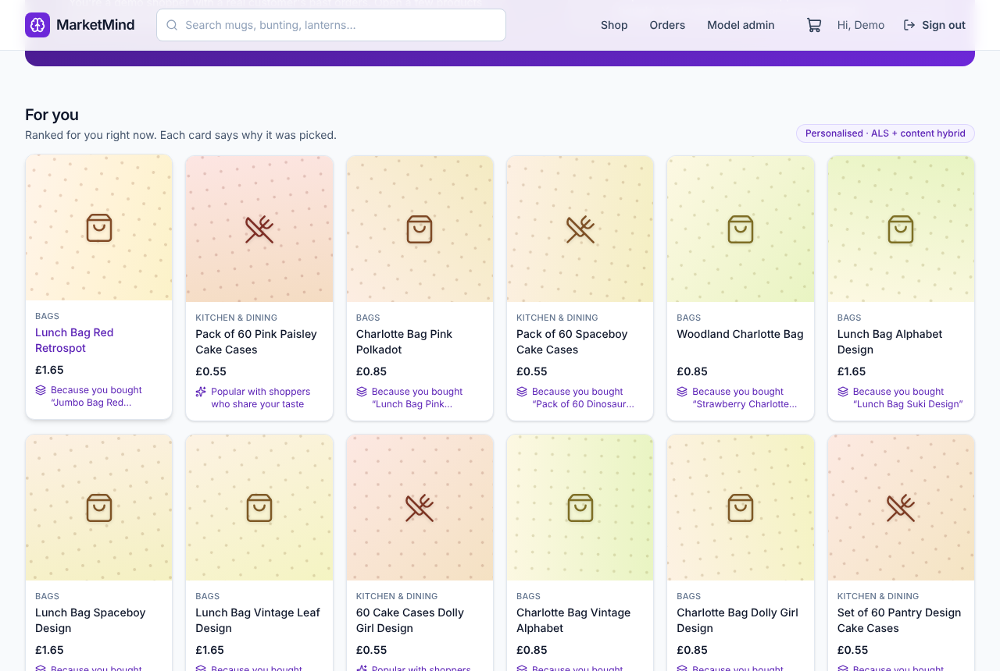
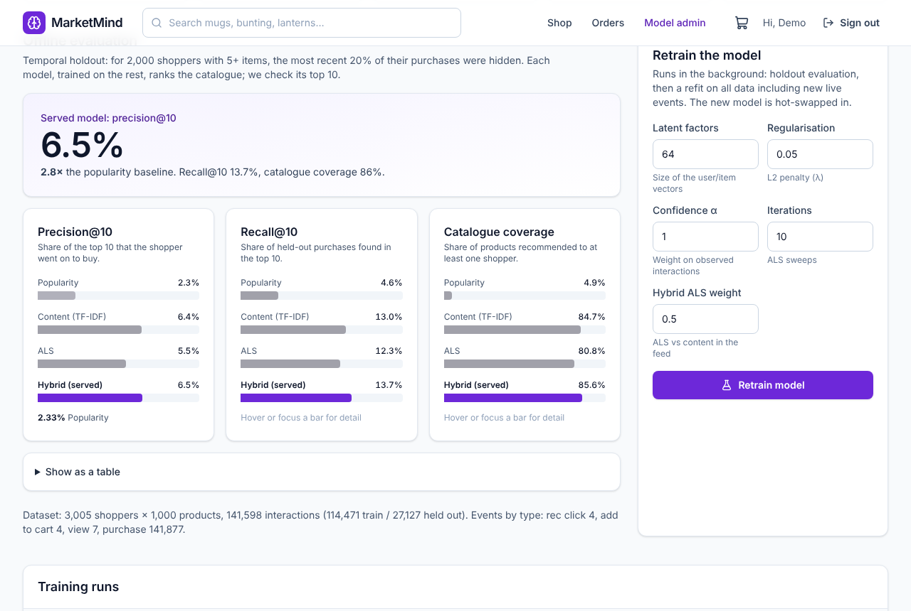
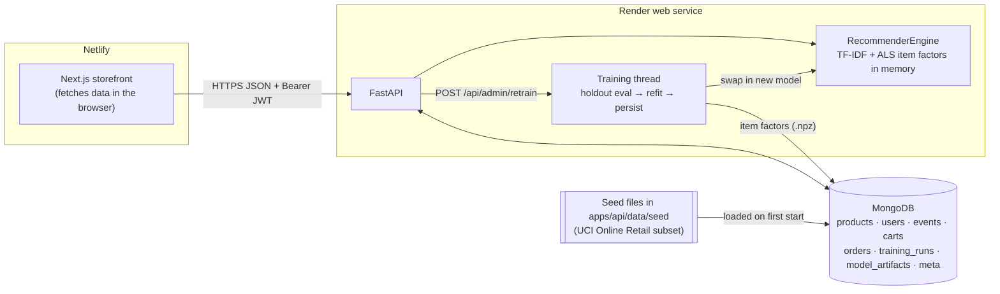
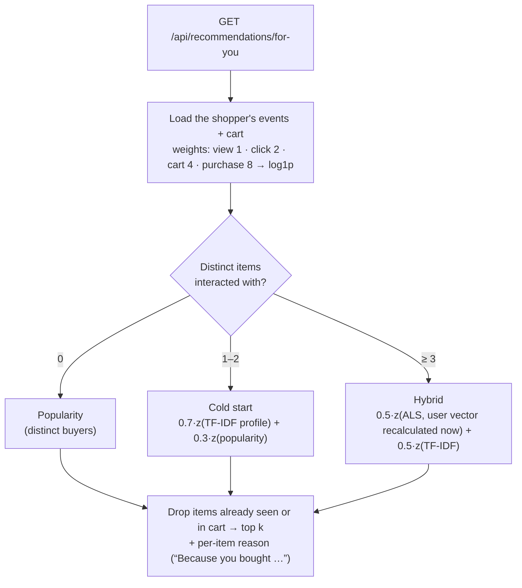

# MarketMind

[](https://github.com/temitopeagbola/MarketMind/actions/workflows/ci.yml)

An e-commerce storefront with an explainable recommendation engine. It's a portfolio demo for anyone
who wants to see, end to end, how an implicit-feedback recommender is built, served and evaluated.

**Production:** https://marketmind.temitopeagbola.com. Netlify deploys the web app from `main`, and the
API runs on Render's free tier.

| For you feed | Model admin |
|---|---|
|  |  |

## Overview

Most shops show the same bestsellers to everyone and can't say why they recommend something. MarketMind
loads 1,000 real products and about 142k customer–product purchases from a UK gift retailer (the UCI
Online Retail dataset). Every shopper action is recorded as implicit feedback: views, recommendation
clicks, cart adds and purchases. From those signals the API builds a personalised **For you** feed. It
blends **ALS collaborative filtering** (the `implicit` library) with **TF-IDF content similarity**,
and uses popularity for shoppers it knows nothing about yet. The shopper's vector is recomputed on
every request, so the feed changes as you browse, and each recommendation says why it was picked. An
admin page shows how each model scores on a temporal holdout and lets you retrain with different
hyperparameters.

## Key features

- **Storefront**
  - search, category filter, sorting and pagination
  - product pages
  - cart and checkout (an order is recorded; no payment is taken)
  - order history
  - sign-up and sign-in
- **One-click demo login.** *Try the demo* creates an isolated shopper whose purchase history is
  copied from a real customer in the dataset.
  - Demo shoppers never share a cart.
  - Their data expires through a MongoDB TTL index.
  - New demo sign-ups are capped per hour.
- **Implicit-feedback tracking**
  - The browser can send `view` and `rec_click` events. Repeat views are de-duplicated.
  - `add_to_cart` and `purchase` are written by the server only, so the browser can't fake them.
- **For you feed.** The strategy depends on how much the API knows about the shopper:
  1. **Popularity** when there's no history.
  2. **Cold start** after 1–2 items: TF-IDF similarity to those items, blended with popularity.
  3. **Hybrid** from 3 items: ALS and TF-IDF blended. The ALS user vector is recalculated from live
     events, so new shoppers get collaborative recommendations without waiting for a retrain.
- **Product page rails.** *Similar items* uses TF-IDF cosine similarity. *Customers also bought*
  uses cosine similarity between ALS item factors.
- **Model admin page**
  - precision@10, recall@10 and catalogue coverage for Popularity, Content, ALS and the served Hybrid
  - training-run history and activity counters
  - a retrain form with validated hyperparameters
  - training runs in a background thread behind a MongoDB lock and a cooldown, and the new model is
    swapped in without a restart
- **Free-tier aware UI.** A health probe and slow-request detection show a *"Waking the server…"*
  banner while the sleeping API starts. Failed requests re-run once it's up.
- **Quality**
  - loading, empty and error states on every view
  - layout works down to 375px wide
  - labelled controls, focus rings, a skip link and live regions
  - strict TypeScript and `mypy --strict`
  - Pydantic validation on every request
  - unit, API, component and Playwright end-to-end tests in CI

## Tech stack

| Layer | Choice |
|---|---|
| Web app | Next.js 16 (App Router), React 19, TypeScript, TanStack Query, Tailwind CSS v4, lucide icons |
| API | Python 3.12, FastAPI, Pydantic v2, pymongo, uvicorn |
| Recommender | `implicit` (ALS), scikit-learn (TF-IDF), NumPy, SciPy |
| Database | MongoDB (`mongo:7` locally, MongoDB Atlas in production) |
| Auth | Email + password (bcrypt) and HS256 JWT bearer tokens |
| API contract | OpenAPI exported from FastAPI. TypeScript types are generated with `openapi-typescript` |
| Tests | pytest + mongomock, Vitest + Testing Library, Playwright |
| Hosting | Netlify (web), Render free Docker web service (API), MongoDB Atlas (database) |
| CI | GitHub Actions ([`.github/workflows/ci.yml`](.github/workflows/ci.yml)) |

No third-party API keys are needed. The dataset is committed and all machine learning runs inside the
API process.

## Architecture



- **The web app fetches all data in the browser.** Pages render straight away and show the wake-up
  banner if the free-tier API is asleep.
- **The API owns everything else**:
  - creates its MongoDB indexes
  - seeds the database on first start
  - loads the newest stored model
  - trains one if none exists
- **Models are stored in MongoDB** (`model_artifacts`) because Render's free disk is wiped on restart.
- **The web app's TypeScript types are generated from the API's OpenAPI schema**
  (`packages/api-contract/openapi.json`), so the two can't drift apart unnoticed.

How a **For you** request is served:



### API

All routes are under `/api`. Interactive docs are at `/docs` while the API is running.

| Area | Routes |
|---|---|
| Health | `GET /health` |
| Auth | `POST /auth/register`, `POST /auth/login`, `POST /auth/demo`, `GET /auth/me` |
| Catalogue | `GET /products`, `GET /products/{id}`, `GET /categories`, `GET /products/{id}/similar`, `GET /products/{id}/also-bought` |
| Recommendations | `GET /recommendations/for-you` (signed in), `GET /recommendations/trending` |
| Events | `POST /events` (signed in) |
| Cart and orders | `GET /cart`, `POST /cart/items`, `PUT /cart/items/{id}`, `DELETE /cart/items/{id}`, `POST /orders`, `GET /orders`, `GET /orders/{id}` (all signed in) |
| Admin | `GET /admin/overview`, `GET /admin/runs`, `GET /admin/runs/{id}`, `POST /admin/retrain` (admin role) |

## Project structure

```
.github/workflows/   CI: API checks, web checks, Playwright e2e, docker compose build
apps/api/            FastAPI service (Python, managed with uv)
  marketmind/        app code: routers/, recsys/ (TF-IDF, ALS, hybrid, metrics), training, seeding
  data/seed/         committed seed data: products, purchase history, demo shopper profile
  scripts/           build_seed.py (rebuild seed from the raw dataset), export_openapi.py
  tests/             pytest suite (unit + API tests on an in-memory MongoDB)
apps/web/            Next.js storefront
  src/app/           pages: home, products, cart, orders, login, admin
  src/components/    UI components
  src/lib/           API client, generated API types, auth, data hooks, helpers
  e2e/               Playwright smoke tests
packages/api-contract/  openapi.json shared by the API and the web app
docs/                design notes (PLAN.md) and screenshots
docker-compose.yml   runs MongoDB + API + web locally
render.yaml          Render Blueprint for the API
netlify.toml         Netlify build settings for apps/web
.env.example         every environment variable, documented
```

## Getting started

### Prerequisites

- **Docker** with Docker Compose v2. This is the only requirement for the one-command setup.
- To run the apps without Docker:
  - **Python 3.12** (`apps/api/.python-version`; the project supports `>=3.12,<3.14`)
  - **[uv](https://docs.astral.sh/uv/)** (CI uses 0.11.32)
  - **Node.js 20.9 or newer** (`engines` in `apps/web/package.json`; CI, Docker and Netlify use Node 22)
  - **MongoDB 7**, either in a container or an Atlas cluster

### Quick start (Docker)

```bash
git clone https://github.com/temitopeagbola/MarketMind.git
cd MarketMind
docker compose up --build
```

- Web app: http://localhost:3000
- API docs: http://localhost:8000/docs

On first start the API seeds MongoDB and trains a model, which takes a few seconds. Until then, the
web app shows a "loading" banner. Stop with `docker compose down`. `docker compose down -v` also
deletes the local database volume.

### Running the apps without Docker

1. **Start MongoDB.** Or point `MONGODB_URI` at an Atlas cluster instead.

   ```bash
   docker run -d --name marketmind-mongo -p 27017:27017 mongo:7
   ```

2. **Set up and start the API.**

   ```bash
   cp .env.example apps/api/.env   # the API reads apps/api/.env; the defaults work locally
   cd apps/api
   uv sync
   uv run uvicorn --factory marketmind.main:app_factory --reload --port 8000
   ```

3. **Set up and start the web app** (in another terminal).

   ```bash
   cd apps/web
   npm ci
   npm run dev                     # http://localhost:3000
   ```

   The web app calls `NEXT_PUBLIC_API_URL`, which defaults to the local API. To point it elsewhere,
   set it in `apps/web/.env.local`.

### Environment variables

All variables are listed with comments in [`.env.example`](.env.example). `.env` and `.env.*` files
are gitignored; never commit real values.

| Variable | Used by | Purpose |
|---|---|---|
| `APP_ENV` | API | `development`, `test` or `production`. Production refuses to start with a weak `JWT_SECRET`. |
| `MONGODB_URI` | API | MongoDB connection string. |
| `MONGODB_DB` | API | Database name. |
| `JWT_SECRET` | API | Secret for signing session tokens. Must be at least 32 random characters in production. |
| `JWT_TTL_MINUTES` | API | Session lifetime. |
| `CORS_ORIGINS` | API | Comma-separated browser origins allowed to call the API. |
| `CORS_ORIGIN_REGEX` | API | Optional regex for extra allowed origins, such as Netlify deploy previews. |
| `AUTO_SEED` | API | Seed the catalogue and purchase history on first start. |
| `TRAIN_ON_STARTUP` | API | Train a model at startup when none is stored. |
| `DEMO_USERS_ARE_ADMIN` | API | Give demo shoppers the admin role so they can open the model dashboard. |
| `DEMO_TTL_HOURS` | API | How long demo shoppers and their data are kept. |
| `DEMO_GLOBAL_LIMIT_PER_HOUR` | API | Cap on new demo shoppers per hour across all visitors. |
| `RETRAIN_COOLDOWN_SECONDS` | API | Minimum gap between admin-triggered retrains. |
| `TRAIN_THREADS` | API | Number of threads `implicit` may use while training. |
| `AUTH_RATE_LIMIT_PER_MINUTE` | API | Per-client limit on register, login and demo requests. |
| `EVENTS_RATE_LIMIT_PER_MINUTE` | API | Per-shopper limit on tracked events. |
| `TRUST_FORWARDED_FOR` | API | Behind a proxy (Render), key rate limits on the right-most `X-Forwarded-For` entry. |
| `NEXT_PUBLIC_API_URL` | Web, at build time | Public URL of the API, built into the browser bundle. |

## Scripts

There are no database migrations. The API creates its indexes and seeds data on startup, and both
steps are idempotent.

**API** (run from `apps/api`)

| Command | What it does |
|---|---|
| `uv sync` | Install dependencies (including dev tools). |
| `uv run uvicorn --factory marketmind.main:app_factory --reload --port 8000` | Run the API with auto-reload. |
| `uv run pytest` | Run the test suite. |
| `uv run ruff check .` / `uv run ruff format --check .` | Lint and check formatting. |
| `uv run mypy` | Type-check (strict). |
| `uv run python scripts/export_openapi.py` | Regenerate `packages/api-contract/openapi.json`. Add `--check` to only verify it's current. |
| `uv run --group seed python scripts/build_seed.py` | Rebuild `data/seed/` from the raw UCI dataset. The download is about 23 MB. |

**Web** (run from `apps/web`)

| Command | What it does |
|---|---|
| `npm run dev` | Start the dev server. |
| `npm run build` / `npm run start` | Production build and server. |
| `npm run lint` | ESLint. |
| `npm run typecheck` | TypeScript (`tsc --noEmit`). |
| `npm test` | Vitest unit and component tests (`npm run test:watch` for watch mode). |
| `npm run test:e2e` | Playwright end-to-end tests (see [Testing](#testing)). |
| `npm run gen:api` | Regenerate `src/lib/api/schema.d.ts` from the OpenAPI contract. |

## Testing

```bash
# API: unit tests and API tests against an in-memory MongoDB (mongomock)
cd apps/api && uv run pytest

# Web: unit and component tests
cd apps/web && npm test

# End-to-end: Playwright against the full stack
docker compose up -d --build
cd apps/web
npx playwright install chromium
E2E_BASE_URL=http://localhost:3000 npm run test:e2e
```

The e2e suite covers:
- the demo shopper's flow from feed to product, cart and order
- the cold-start feed for a new account
- retraining from the admin page
- the "waking server" banner
- desktop and 375px-wide viewports

It expects `RETRAIN_COOLDOWN_SECONDS=0`, which `docker-compose.yml` sets. Without `E2E_BASE_URL`,
Playwright starts the web app itself with `npm run start`. That needs `npm run build` first and an API
on port 8000; this is how CI runs it.

CI ([`.github/workflows/ci.yml`](.github/workflows/ci.yml)) runs on every push and pull request:

- **API:** ruff, ruff format check, mypy, pytest and the OpenAPI drift check.
- **Web:** generated-types drift check, ESLint, tsc, Vitest and the production build.
- **E2E:** Playwright against MongoDB and the API.
- **Docker:** `docker compose build`.

### Model evaluation

The admin page reports these metrics for every training run:

- Each shopper with at least 5 items has the most recent 20% of their items held out. Up to 2,000 of
  these shoppers are sampled.
- Each model ranks all products, excluding the shopper's training items, and the top 10 are scored.
- The evaluation calls the same `HybridRecommender` code that serves shoppers.

On the committed seed data, a startup training run during development gave these results:

| Model | Precision@10 | Recall@10 | Catalogue coverage |
|---|---:|---:|---:|
| Popularity | 2.3% | 4.6% | 4.9% |
| Content (TF-IDF) | 6.4% | 13.0% | 84.7% |
| ALS (`implicit`) | 5.6% | 12.6% | 81.9% |
| **Hybrid (served)** | **6.6%** | **13.9%** | **86.1%** |

Content similarity is strong on this catalogue because gift buyers collect matching ranges (for example
"Jumbo Bag Red Retrospot" and "Lunch Bag Red Retrospot"). ALS adds signal across ranges, and the blend
beats both. TF-IDF uses product titles only, because adding the category name lowered content
precision on this holdout (see `apps/api/marketmind/recsys/content.py`).

## Deployment

The repo deploys to three free-tier services: the API to Render, the web app to Netlify, and the
database to MongoDB Atlas.

1. **MongoDB Atlas**
   - Create an M0 cluster. AWS `eu-central-1` sits next to the Render region (`frankfurt`) set in
     `render.yaml`.
   - Add a database user.
   - Under *Network Access*, allow `0.0.0.0/0`, because Render's free tier has no static outbound IPs.
   - Copy the `mongodb+srv://…` connection string.
2. **Render (API)**
   - [`render.yaml`](render.yaml) is a Blueprint for a free Docker web service named `marketmind-api`.
     It uses `apps/api/Dockerfile` with health check `/api/health`.
   - In Render, choose *New → Blueprint* and select this repo, then enter `MONGODB_URI` when prompted.
   - `JWT_SECRET` is generated by Render. The other variables are set in the Blueprint.
   - On first boot the API seeds the database and trains a model in the background. `/api/health`
     reports `ready` and `model_version` as this progresses.
3. **Netlify (web)**
   - [`netlify.toml`](netlify.toml) builds `apps/web` with the Next.js runtime.
   - The production site `marketmind2` serves `marketmind.temitopeagbola.com` and deploys from `main`.
   - Set `NEXT_PUBLIC_API_URL` to the Render service URL in the site's environment variables.
     Production builds fail on purpose if it's missing.
   - Deploy previews are allowed to call the API through `CORS_ORIGIN_REGEX` in `render.yaml`.

### Why `implicit` instead of TensorFlow

The original plan used TensorFlow. It was swapped for `implicit` ALS so the API fits Render's 512 MB
free instance:

- `implicit` is a small library built for collaborative filtering on implicit feedback.
- ALS user vectors can be solved directly from the item factors. So only the item factors are stored,
  and each request recomputes the shopper's vector from their live events.
- Measured locally during development:
  - the API peaked at about 250 MB of memory while seeding and training, and idled at about 150 MB
  - a full train with holdout evaluation took about 5 seconds on one thread

## Security notes

What's in place:

- Passwords are hashed with bcrypt, with a SHA-256 pre-hash so passphrases over 72 bytes aren't
  truncated.
- Unknown emails are checked against a dummy hash, so login timing doesn't reveal which accounts exist.
- Request models reject unknown fields, so a client can't set its own `role`.
- Search input is escaped before it reaches MongoDB.
- The API has a CORS allowlist and security headers. The web app sets a Content-Security-Policy and
  guards against open redirects in `?next=`.
- Containers run as non-root users.
- Auth and event endpoints are rate-limited.

Known trade-offs:

- The session token is kept in `localStorage` because the web app and API are on different sites.
  The Content-Security-Policy limits the XSS risk; an `api.` subdomain with `httpOnly` cookies would be
  stronger.
- Demo shoppers are admins so reviewers can try retraining. The only admin action is a
  cooldown-limited retrain.
- Rate limits are kept in memory per API instance. Scaling out would need a shared store such as Redis.
- There's no email verification or password reset.
- ESLint stays on v9 until the React and accessibility lint plugins support v10.

## Contributing

There's no `CONTRIBUTING.md`; the flow is:

1. Create a branch from `main`.
2. Make your change, with tests.
3. If you changed the API's request or response models, regenerate the contract and the web app's
   types: `uv run python scripts/export_openapi.py` in `apps/api`, then `npm run gen:api` in
   `apps/web`.
4. Run the checks listed under [Testing](#testing).
5. Open a pull request and wait for CI to pass before merging.

## Data

The product catalogue and purchase histories come from Daqing Chen, *Online Retail*, UCI Machine
Learning Repository, [doi:10.24432/C5BW33](https://doi.org/10.24432/C5BW33), licensed CC BY 4.0.
`apps/api/scripts/build_seed.py` prepares it as follows:

- Drops cancellations, non-product lines and rows without a customer.
- Keeps the 1,000 most-bought products and 3,000 random customers with at least 5 items each.
- Derives readable titles and keyword-based categories, and uses each product's median price.
- At seed time, shifts timestamps so the history ends "yesterday".

## License

All rights reserved. The repository has no LICENSE file. The dataset keeps its own CC BY 4.0
licence.
